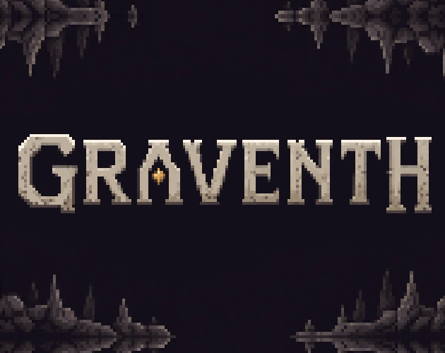
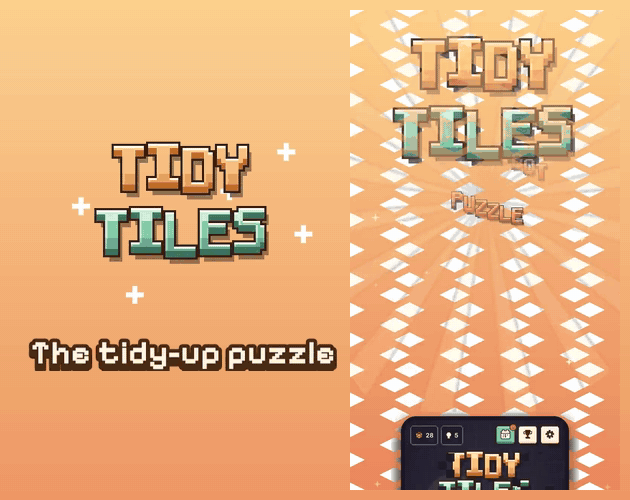
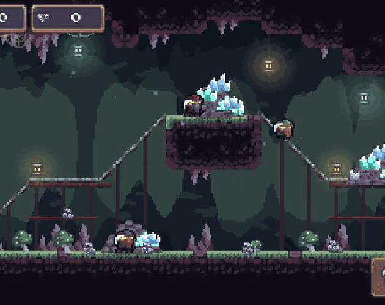
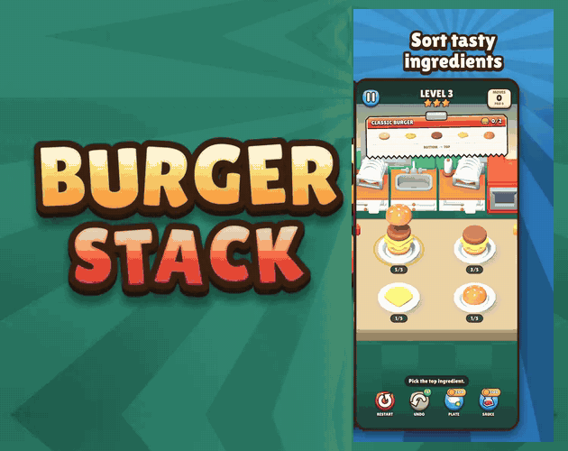
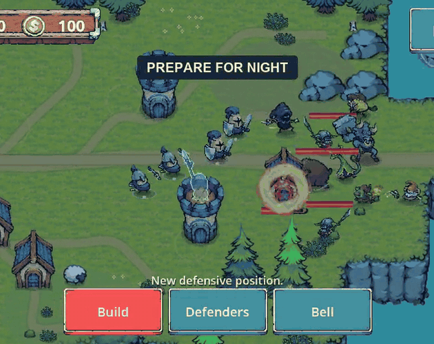
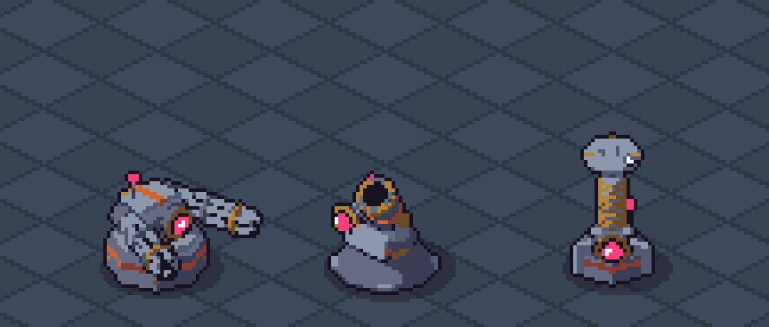
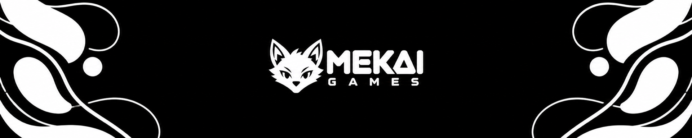

  

  
  
  

  
  
  
  

<h2 align="center">We're Mekai Games, an independent studio from Italy.</h2>

  We make mobile games, PC games on Steam and pixel art asset packs for other developers.

---

## 🎮 Our games

<table>
  <tr>
    <td width="50%" align="center">
      
       <b>GRAVENTH</b>
       Descend into dangerous caves, mine resources, fight creatures and escape with your loot.
       PC · Steam
       
    </td>
    <td width="50%" align="center">
      
       <b>Tidy Tiles</b>
       A cozy sliding puzzle: guide a tiny robot vacuum and clean every dusty tile.
       iOS
       
    </td>
  </tr>
  <tr>
    <td width="50%" align="center">
      
       <b>Mine Fever</b>
       A fast pixel art mining roguelite: dig, collect gems and push deeper every run.
       iOS
       
    </td>
    <td width="50%" align="center">
      
       <b>Burger Stack</b>
       Stack and sort burgers in a quick, juicy puzzle game.
       iOS
       
    </td>
  </tr>
  <tr>
    <td width="50%" align="center">
      
       <b>Hearthtide</b>
       Build your island village by day and defend it from the tide by night.
       iOS
       
    </td>
    <td width="50%" align="center">
      
       <b>Robot Series</b>
       Animated pixel art robots for your games, 8 directions.
       Asset packs · itch.io
       
    </td>
  </tr>
</table>

## 🛠️ How we build

  
  
  
  
  

## 📬 Contact

Business and press: [mekai.official.games@gmail.com](mailto:mekai.official.games@gmail.com)

  

